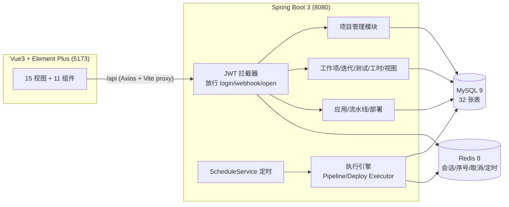

# DevFusion 系统设计

一句话结论：**参照 ONES 的项目管理主干 + 简单云的 CI/CD 主干，用 Vue3 + Spring Boot 3 + MySQL + Redis 搭起一体化研发管理平台，32 张表、22 个后端模块、26 个前端页面/组件，研发闭环（规划→迭代→看板→测试→构建→审批→部署→回滚）全部跑通；82 个 Playwright e2e 用例两轮连跑全绿。**

## 1. 调研结论（取舍依据）

调研报告全文见 [research-ones.md](./research-ones.md) 与 [research-simplecloud.md](./research-simplecloud.md)；逐条落地状态见 [gap-analysis.md](./gap-analysis.md)；UI 令牌与改版规范见 [ui-guidelines.md](./ui-guidelines.md)。

| 来源 | 采纳的设计 | 落地方式 |
|---|---|---|
| ONES | 统一工作项模型（需求/任务/缺陷共用状态+工作流底座） | 单表 `work_item` + `type` 字段 |
| ONES | 项目级可配置工作流，每类型独立状态列表 | `work_item_status`（项目×类型×状态，含 category 归类） |
| ONES | 父子层级、看板列绑状态拖拽、迭代 | `parent_id` / Board 拖拽 / 迭代状态机 |
| ONES | 燃尽图（工作项数/故事点，按日采点） | `GET /api/iterations/{id}/burndown`，从 `work_item_activity` 重算 |
| ONES | Backlog 待规划/已规划双区拖拽 | `BacklogController` + `BacklogPanel` |
| ONES | 测试计划 + 执行历史 + 逐用例执行人 | `test_plan` / `test_plan_case` 两表 |
| ONES | 工时（预估/剩余/实际） | `worklog` 表 + 工作项三字段 |
| ONES | 已保存视图（筛选器落库） | `work_item_view` 表 |
| 简单云 | 流水线 = 串行 Stage × Job 两级，一个插件实例 = 一个 Job | `pipeline_stage` / `pipeline_job` |
| 简单云 | Stage 内 Job 并行 | `pipeline_job.parallel`（MySQL 保留字，实体上反引号） |
| 简单云 | 人工审批 Job + 部署单审批 | `run_job=WAITING_APPROVAL` / `deployment=PENDING_APPROVAL` |
| 简单云 | 制品"半成品/成品"版本分离与晋级 | 构建成功自动归档 + `promote` 晋级接口 |
| 简单云 | 个人令牌 + OpenAPI 免登触发 | `access_token` 表 + `/api/open/**` 放行 |
| 简单云 | 定时触发、参数化触发、子流水线、质量门禁、Job 超时 | ScheduleService / run 参数 / 插件 / Job 配置 |
| 简单云 | 部署单四步模拟 + 回滚 | 部署单模拟执行引擎；`deploy_type=ROLLBACK` |
| 简单云 | 工作台、站内通知、效能度量、部署模板、主机组 | Workbench / notification / metrics / deploy_template / host(_group) |

## 2. 架构



- **鉴权**：登录签发 JWT（jti），会话存 Redis（`df:session:{jti}`）；WebConfig 放行 `/api/auth/login`、`/api/webhook/**`、`/api/open/**`（PAT 触发）。密码 BCrypt。
- **编号生成**：工作项/用例编号用 Redis `INCR df:seq:{projectId}:{type}`；DataSeeder 走同一计数器。
- **执行引擎**：触发时把 stage/job 复制成 run 快照（`run_stage`/`run_job`），编辑流水线不影响进行中的 run；Job 支持 `parallel` 并行与 `WAITING_APPROVAL` 暂停审批；取消标志在 Redis `df:cancel:run:{id}`，**取消优先于失败**。
- **模拟执行**：构建命令不真实执行，日志按插件类型生成（SHELL 逐行回显、`exit 1` 触发失败）；变量中 `secret=true` 的在日志里打码为 `********`。

## 3. 数据模型（32 张表）

| 域 | 表 |
|---|---|
| 组织权限 | `user`、`project`、`project_member`、`access_token` |
| 项目管理 | `work_item_status`、`iteration`、`work_item`、`work_item_comment`、`work_item_activity`、`work_item_view`、`worklog`、`release` |
| 测试 | `test_case`、`test_plan`、`test_plan_case` |
| DevOps 编排 | `application`、`environment`、`pipeline`、`pipeline_stage`、`pipeline_job`、`pipeline_variable` |
| DevOps 执行 | `pipeline_run`、`run_stage`、`run_job`、`run_variable`、`run_work_item` |
| 制品与部署 | `artifact`、`deployment`、`deploy_template`、`host_group`、`host` |
| 平台支撑 | `notification` |

DDL 见 `backend/src/main/resources/schema.sql`（含增量列：`pipeline_job.parallel`、`work_item` 工时三字段等）；首次启动由 `DataSeeder` 写入演示数据。

## 4. API 概览（前缀 /api，统一 `{code,msg,data}` 包装）

- `auth`：login / logout / me；`open`：PAT 触发 `POST /open/pipelines/{id}/trigger`（免登录）
- `users`：分页 CRUD + 重置密码 + simple；`tokens`：PAT CRUD
- `projects`：CRUD + 成员 + `/statuses` 工作流 + `/board` 看板 + `/backlog`（unplan/plan）+ `/releases` + `/test-plans` + `/views`
- `items`：详情/更新/删除 + `transition` 流转 + comments + activities + `/worklogs` 工时 + batch-update / batch-delete
- `iterations`：CRUD + 状态机 + `/{id}/burndown?metric=ITEM|STORY_POINT`
- `test-cases`：CRUD + execute（PASS/FAIL/BLOCKED）+ `/executions` 历史 + test-stats
- `test-plans`：CRUD + `/cases`（挂用例/移除）+ `/executors` 设执行人 + `/execute`
- `applications` / `pipelines`：CRUD + 编排全量保存 + `/run` 触发 + `/variables` 变量管理；`runs`：列表/详情/取消/`/work-items` 关联 + `/{jobId}/approve|reject`
- `environments` / `artifacts`（含 promote）/ `deployments`（含 rollback / cancel / approve / reject）/ `deploy-templates` / `host-groups`（含 `/hosts`）
- `dashboard`：global、`/project/{id}`、`/project/{id}/bug-report`、`/metrics`
- `notification`：list / unread-count / `/{id}/read` / read-all；`workbench`：我的工作台聚合

## 5. 非目标（明确不做）

- 真实 Git 托管、代码评审、真实代码事件触发——需要 git server
- 真实构建执行器（docker/maven 真跑）、Agent/SSH 真实部署、K8S/Helm——用模拟引擎替代
- IM / 邮件推送（站内通知已替代）、SonarQube 外部门禁
- ONES 的 Wiki、甘特图、里程碑视图、Excel 导入导出、自定义字段引擎、组件库式导航、附件/Watcher/Link

## 6. 本地运行

```bash
# 1. 依赖：MySQL 9 + Redis 8（brew services start mysql redis）
mysql -uroot -e "CREATE DATABASE devfusion DEFAULT CHARACTER SET utf8mb4;"
mysql -uroot devfusion < backend/src/main/resources/schema.sql

# 2. 后端（首次启动自动写入演示数据）
cd backend && mvn spring-boot:run

# 3. 前端
cd frontend && npm install && npm run dev   # http://localhost:5173

# 4. e2e（82 个用例）
cd e2e && npm install && npx playwright install chromium && npx playwright test
```

CORS：跨域来源由 `application.yml` 的 `devfusion.cors.allowed-origin` 控制，默认 `http://localhost:5173`，改前端端口时同步改。

演示账号：`admin / admin123`（管理员）、`zhangwei / lina / wangqiang`（成员，同密码）。
