# ONES 功能调研报告

> 调研时间：2026-10-14（实时抓取 docs.ones.com 帮助文档与官网功能页）。用途：指导 DevFusion 的功能取舍与 UI 改版。

## 摘要

本轮实证确认的硬数字：**1 个枢纽产品（ONES Project）+ 8 类模块**；工作项列表有 **5 种布局**（窄详情 / 宽详情 / 列表 / 看板 / 文档）；每个工作项类型组件自带 **4 个公共视图**（未规划 / 已规划 / 已完成 / 全部）；燃尽图 **3 种**（工作项 / 剩余工时 / 故事点）；测试计划执行结果分 **4 种**（通过 / 失败 / 阻塞 / 跳过）；项目导航由 **20+ 个可拖拽组件**拼装；工作项字段类型实证 **4 大类约 14 种**（文本 3、选择 3、日期时间 2、人员/迭代/数字等 6），旧版"37 种"说法本轮未逐项核实，不作结论。DevFusion 已实现其中约 **30%**（统一工作项模型、三类型、看板、迭代状态机、用例执行留最新结果），缺口集中在：已保存视图/筛选器、Backlog 双区拖拽规划、燃尽图、测试计划与执行历史、工时、发布与里程碑、报表组件、Wiki、组件化导航。

## 来源 URL 列表（本轮实时抓取）

| 主题 | URL |
|---|---|
| 燃尽图（3 种类型与数据源） | https://docs.ones.com/zh-Hans/ones-project/components/components-for-scrum-development/sprint-component/burndown-chart/ |
| 迭代组件（概览布局、阶段、字段） | https://docs.ones.com/zh-Hans/ones-project/components/components-for-scrum-development/sprint-component/ |
| 待办事项 Backlog 组件（双区、拖拽、工作量评估） | https://docs.ones.com/zh-Hans/ones-project/components/components-for-scrum-development/backlog-component/ |
| 工作项类型组件（视图、5 种布局、批量操作） | https://docs.ones.com/zh-Hans/ones-project/components/issue-type-component/ |
| 测试计划与执行（计划、执行人、追溯矩阵） | https://docs.ones.com/zh-Hans/ones-testcase/test-plan-and-execution |
| 瀑布组件（甘特、里程碑、交付物、执行） | https://docs.ones.com/ones-project/components/components-for-waterfall-project-planning/ |
| 里程碑管理 | https://docs.ones.com/zh-Hans/ones-project/components/components-for-waterfall-project-planning/gantt-component/milestone-management/ |
| 工作项字段类型 | https://docs.ones.com/zh-Hans/ones-project/issues/issues-field-types/ |
| 详情页布局配置（选项卡/组/字段/联动） | https://docs.ones.com/zh-Hans/ones-project/issues/issue-layout/details-page-configuration/ |
| 报告组件（字段报告 / 缺陷分析） | https://docs.ones.com/zh-Hans/ones-project/components/other-basic-functional-components/report-component |
| 仪表盘小部件 | https://docs.ones.com/get-started/manage-your-workspace/ |
| 测试报告模板 | https://docs.ones.com/ones-testcase/test-reports?fallback=true |
| 工作项 API 固有字段（含工时字段） | https://developer.ones.cn/docs/api/project/task/ |

## 产品形态与导航（官网实证）

```mermaid
flowchart LR
  subgraph 全局栏["全局左侧深色导航条（实证截图）"]
    G1[My work 我的工作]
    G2[ONES Project]
    G3[ONES Wiki]
    G4[ONES TestCase]
    G5[Product management 产品管理]
    G6[Time management 工时]
    G7[Version management 版本]
    G8[Configuration 配置-底部]
  end
  subgraph 项目内["项目内顶栏（白色）"]
    T1[项目名下拉]
    T2[模块页签：需求/迭代/缺陷/任务/概览/报表/...]
    T3[右侧：搜索/+/帮助/设置/铃铛/头像]
  end
  subgraph 组件库["项目设置-项目组件（可拖拽进导航）"]
    C1[项目概览/项目计划/迭代/迭代计划/发布]
    C2[需求/缺陷/任务/用户故事/Backlog/待办事项]
    C3[看板/筛选器/时间视图/甘特/里程碑/交付物]
    C4[文档/文件/成员/报表/流水线/工单/执行]
  end
  全局栏 --> 项目内 --> 组件库
```

- 项目导航不是固定菜单，而是"组件库 → 拖进自定义导航栏"，每个组件可单独启停、配数据范围、配权限（实证截图见迭代设置页与 Backlog 数据范围页）。
- 迭代组件内部再分左侧栏（Unplanned issues / All issues / Create sprint + 迭代列表）与右侧页签（Overview / Scrum board / Requirement / Bug / All issues）。
- 配色：浅色主题，主色为蓝（按钮与链接），状态用圆角药丸（To do 蓝边、In progress 橙、Done 绿），优先级用红/橙/蓝色块；信息密度高，列表行高约 40px。

## 工作对象模型

| 对象 | 实证要点 | 来源 |
|---|---|---|
| 工作项 Issue | 需求/任务/缺陷/用户故事共用状态、字段、工作流底座；每类型独立配置 | issue-type-component |
| 字段类型 | 单行文本、多行文本、富文本；单选、多选、内部数据引用；日期、时间；单选成员、多选成员、单选迭代；整数、浮点数 | issues-field-types |
| 详情页布局 | 可配置选项卡、分组、字段、控件；支持默认值、必填、显示条件、字段值联动 | details-page-configuration |
| 详情抽屉页签 | Details / Duration and progress / Subissue（子项）/ Link（关联）/ Time（工时）；右侧 Activity 面板分 All / Comment / Attachment / More；底部 Watcher | burndown-chart 截图 |
| 列表视图 | 公共视图（仅管理员建）+ 私有视图；每类型 4 个公共视图（未规划/已规划/已完成/全部）；工具栏含 Save / Save as / Restore、Layout、Structure（展开树）、Sort by、Group by、Filters、列设置齿轮 | issue-type-component |
| 列表布局 | 窄详情（列表+右抽屉）、宽详情、列表、看板、文档 共 5 种 | issue-type-component |
| 批量操作 | 批量改类型、转子项、转普通工作项、改父项、改字段、复制、删除、移动、导入、导出、查看统计报告 | issue-type-component 截图 |

## Scrum 主链路

| 环节 | 实证要点 | 来源 |
|---|---|---|
| Backlog | 分"待规划 / 已规划"双区；待规划按优先级排序，拖进迭代或发布；左侧发布栏显示发布进度、发布日期、含/已完成工作项数 | backlog-component |
| 工作量评估 | 迭代卡片显示"当前工作量 / 推荐工作量"；当前=迭代内故事点之和；推荐=已完成迭代故事点均值×当前迭代天数；超配显示⚠️ | backlog-component |
| 迭代概览 | Sprint info（负责人、To do/In progress/Done 计数、计划起止、预估/剩余工时、进度%）+ 燃尽图 + 当前阶段时间轴 + 阶段描述 + 迭代自定义字段 | sprint-component |
| 燃尽图 | 3 种：工作项数、剩余工时、故事点；虚线为基线；基线取首日未完成项数直线下降；次日起按当日 23:59 未完成数采点 | burndown-chart |
| 迭代阶段 | 默认 To do / In progress / Done 三段，可自定义增减；阶段可改名、排序；固定阶段不可删 | sprint-component |

## 测试链路

| 环节 | 实证要点 | 来源 |
|---|---|---|
| 用例库 | 用例模块树（可控制是否显示子模块用例）；自定义用例字段配置（默认值、必填）；Excel 导入导出 | test-plan-and-execution / test-case-field |
| 测试计划 | 名称、经办人、测试阶段、关联项目、关联迭代、缺陷事务类型映射、查看/编辑权限 | test-plan-and-execution |
| 执行 | 用例库挂到计划后逐条设执行人；结果 4 种：Passed / Failed / Blocked / Skipped；批量"更改结果"；可要求按结果必填说明与附件 | test-plan-and-execution |
| 追溯矩阵 | 需求 → 关联用例结果 → 关联 Bug 三列矩阵，按需求分组展开 | test-plan-and-execution 截图 |
| 测试报告 | 模板可拖拽编排：Overview、Bug 优先级报告、Bug 模块报告、用例结果报告、关联 Bug 列表、富文本组件 | test-reports |

## 瀑布与其他模块

| 模块 | 实证要点 | 来源 |
|---|---|---|
| 甘特图 | 表格 + 甘特双栏；WBS 分解；基线起止、基线偏差、延期时长；依赖关系 | gantt-component / gantt-and-list-actions |
| 里程碑 | 工作项勾选"标记为里程碑"即变菱形；可仅有完成日期或含起止日期 | milestone-management |
| 工时 | 工作项页签 Time：Time estimated / Time spent / Time remaining / Deviation / Working time progress%；Log time 逐条登记 | burndown-chart 截图 / task API |
| 报表组件 | 字段报告、工作项增长趋势、工作日志报告；缺陷报告另含平均缺陷年龄、新建 vs 已解决、检测率、逃逸率、重开 | report-component |
| 仪表盘 | 小部件：Report、Custom report、Sprint overview、Number（筛选器计数）、Issue list（筛选器结果列表） | manage-your-workspace |

## 权限模型（实证要点）

- 组件级权限：项目权限、迭代权限、里程碑计划权限、交付物权限、工作项权限、Backlog 拖拽权限分别配置（Backlog 组件设置截图）。
- 测试计划独立设查看/编辑成员域；关联项目时项目成员默认进成员域。
- 公共视图仅项目管理员可建。

## 对 DevFusion 的落地建议（骨架）

**P0（研发闭环必需、本地可模拟）**：燃尽图（按日从 work_item_activity 重算未完成工作项数）、Backlog 待规划/已规划双区拖拽规划、测试计划实体 + 执行历史表（替代只存 latest_result）、迭代概览页（Sprint info 卡片 + 燃尽图）。

**P1（体验补齐）**：已保存视图/筛选器、列表排序分组与列配置、批量操作、工时登记（预估/剩余/实际三字段）、发布（Release）实体、工作项详情页签（子项/关联/工时）、缺陷分析报表。

**P2（依赖外部或成本高，可列非目标）**：甘特图与基线、里程碑菱形视图、Wiki、Excel 导入导出、IM/邮件通知、组件库式自定义导航、多级权限矩阵、附件与 Watcher。
